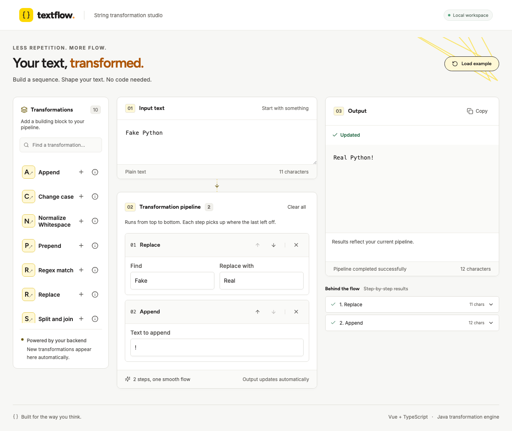

# Textflow

A no-code string transformation studio for the KNIME full-stack assignment. Compose transformations, configure them through backend metadata, and inspect each step's result.



## Requirements

- Java 25 LTS (verified with Temurin 25.0.4.1).
- Node.js 24 (verified with 24.10.0) and npm (verified with 11.18.0).
- Internet access for the first dependency installation. Maven 3.9.11 is downloaded by the checked-in wrapper; no global Maven installation is needed.

## Build and run

From the repository root:

```sh
./scripts/build.sh
java -jar backend/web-api/target/web-api-1.0.0.jar
```

Open http://127.0.0.1:8080. The executable JAR serves both the Vue production build and Java API. `PORT=8081 java -jar ...` changes the port. The server binds to loopback by default. Stop it with Ctrl-C.

The bundled example replaces `Fake` with `Real` in `Fake Python`, then appends `!`, producing `Real Python!`. Add steps from the library, edit their fields, move them with the arrow buttons, and see the output update automatically. Input and pipeline edits automatically refresh the final output and step results after a 300 ms debounce. Obsolete requests are cancelled and older responses are ignored. The initial example also previews automatically; clearing the pipeline shows the original input. Desktop keeps a sticky preview alongside the editor; mobile offers a persistent **View output** control. During updates the last successful result remains visible, labeled **Previous result**, with copying disabled until a current result arrives. Errors retain that previous preview with **Needs attention**; configuration survives errors. Output and individual step results preserve line breaks.

When the pipeline is empty, the UI shows the input unchanged without calling the execution API. Input edits update this preview immediately, preserving whitespace and line breaks. Clearing the pipeline cancels pending execution and clears previous step results and execution errors; if the input is also empty, the preview returns to its empty state. Discovery still runs. Adding a step resumes backend previews, including for empty or whitespace-only input.

## Run with Podman

The root `Dockerfile` builds and tests the Vue frontend and Java modules, then copies the combined application into a non-root Java 25 runtime image. Local Java, Node, and Maven installations are not required for this build. Base images use explicit Node 24.10.0 and Temurin 25.0.4.1 versions; update these tags deliberately when updating the toolchain. The `.dockerignore` excludes local dependencies, build output, environment files, and unrelated repository files.

On macOS or Windows, initialize a Podman machine once with `podman machine init` if none exists, then start it with `podman machine start` if it is stopped. Linux can run Podman directly. From the repository root:

```sh
podman build -t localhost/textflow:local .
podman run -d --name textflow -p 127.0.0.1:8080:8080 localhost/textflow:local
```

Open http://127.0.0.1:8080. If another application uses port 8080, change only the host side of the mapping, for example `-p 127.0.0.1:8081:8080`. The container listens on all its interfaces so port forwarding works; the host mapping keeps access local. No volumes or database are needed; workflow persistence is not implemented.

```sh
podman logs -f textflow    # Ctrl-C stops following logs, not the app
podman stop textflow
podman start textflow
```

Each metadata or transformation API request writes a console log with its method, endpoint, HTTP status, and elapsed milliseconds, for example `POST /api/transform status=200 durationMs=2`. The logs omit input/output text, parameter values, query strings, and headers. Edits trigger logs when the debounced preview request reaches the backend; browser-only actions do not. Follow new activity with `podman logs --tail 100 -f textflow`. After replacing a container, rerun the logs command to follow the new container.

After code changes, rebuild the image, then replace the existing application container:

```sh
podman build -t localhost/textflow:local .
podman stop textflow
podman rm textflow
podman run -d --name textflow -p 127.0.0.1:8080:8080 localhost/textflow:local
```

The first build downloads base images and dependencies. Subsequent builds reuse unchanged layers. Frontend unit tests, type checks, the production build, Java unit tests, and HTTP integration tests run during image creation; Playwright browser tests remain a separate check. The same Dockerfile also works with Docker using equivalent `docker build` and `docker run` commands.

## Development

Build the Java modules once, then run the backend:

```sh
cd backend
./mvnw package
java -jar web-api/target/web-api-1.0.0.jar
```

In a second terminal:

```sh
cd frontend
npm ci
npm run dev
```

Open the Vite URL, normally http://127.0.0.1:5173. Vite proxies `/api` to port 8080. Frontend changes hot reload. Rebuild and restart the Java JAR after backend changes. Rebuild the frontend before packaging to refresh the bundled UI.

## Verification

```sh
cd frontend
npm test
npm run build             # strict TypeScript checks + production build
cd ../backend
./mvnw verify             # core unit tests + live HTTP integration tests
```

For the browser test, build the application first, stop any stale server on port 8080, then:

```sh
cd frontend
npx playwright install chromium
npm run test:e2e
```

Playwright starts the packaged Java server if none is running. It exercises the real API, composition, editing, reordering, validation, and mobile overflow. It also writes desktop/mobile screenshots to `docs/`. No separate lint configuration is installed; TypeScript and the builds enforce compilation checks.

## API

`GET /api/transformations` returns descriptors containing `id`, `name`, `description`, and `parameters`. Each parameter has an ID, label, generic type, required flag, default, optional numeric bounds, enum options, and help text.

```sh
curl http://127.0.0.1:8080/api/transformations
curl http://127.0.0.1:8080/api/transform \
  -H 'Content-Type: application/json' \
  -d '{"input":"Fake Python","pipeline":[{"transformation":"replace","parameters":{"old":"Fake","new":"Real"}},{"transformation":"append","parameters":{"text":"!"}}]}'
```

Execution returns `{"output":"Real Python!","steps":[...]}`. Each step result includes its zero-based `index`, transformation ID, and output. An empty pipeline returns the input unchanged.

Validation errors return HTTP 400 with `message`, nullable zero-based `step`, and nullable `parameter`. Requests over 1 MiB return 413. Input and each intermediate output are capped at 100,000 UTF-16 code units; pipelines at 30 steps; regex patterns at 500 characters. No partial execution is reported as successful. Unknown parameters are rejected; omitted parameters use declared defaults; explicit empty strings, zero, and false remain distinct from missing values.

## Transformations and semantics

| Operation | Behavior |
| --- | --- |
| Replace | Literal, case-sensitive, non-overlapping replacement of every occurrence. Find cannot be empty; replacement may be empty. |
| Append / prepend | Add literal text, including whitespace and line breaks. |
| Substring | Zero-based Unicode code-point indices; start inclusive, end exclusive; invalid bounds are errors. |
| Regex match | RE2 syntax, all full matches joined with `\n`; no match produces empty text. Zero-width matches follow RE2/J matcher iteration. Lookaround and backreferences are unsupported. |
| Change case | Upper/lowercase using `Locale.ROOT`; may change text length. |
| URL encode/decode | UTF-8 URL **component** encoding: spaces become `%20`; only letters, digits, `-._~` stay unescaped. Decode percent escapes once; literal `+` stays `+` (not form decoding). Malformed escapes, invalid UTF-8, and invalid Unicode are errors. |
| Split and join | Literal, case-sensitive split separator (default `,`); join separator defaults to ` · `. Preserves leading, trailing, and repeated empty items and item whitespace. Empty join separator is allowed; empty split separator is an error. No regex or escape-sequence interpretation. |
| Normalize Whitespace | Collapse Unicode whitespace to single ASCII spaces. By default trim each line and preserve blank lines; line endings (CRLF, CR, LF, VT, FF, NEL, LS, PS) become LF. Disable **Preserve line breaks** to flatten the text; disable **Trim edges** to retain one boundary space. Includes non-breaking spaces, excludes zero-width spaces. |
| Trim whitespace | Java `String.strip()` semantics (`Character.isWhitespace`), not every Unicode separator such as non-breaking space. |

## Architecture and extensions

See [architecture](docs/architecture.md) and [AI usage record](docs/ai-usage.md). The Java library has no web-framework dependencies. The server handles HTTP and calls the processor. The Vue application renders generic parameter controls; there is no transformation-ID switch for configuration or execution. Only the optional example loader names specific operations.

To add an operation, add a public class implementing `Transformation` and annotate it with `@AutoService(Transformation.class)`. Metadata and processing logic live together in that class. The compiler generates Java SPI registration; `TransformationDiscovery` loads providers in stable ID order. No central list, controller, or frontend edits are needed. Rebuild, restart the server, and reload the browser. See [adding a transformation](docs/adding-transformations.md) for a copyable example. `ProcessorTest.discoversAnnotatedClassWithoutRegistryChanges` verifies discovery and execution of a test-only provider; the UI test renders and executes previously unknown metadata.

## Performance

See [measurements and implementation notes](docs/performance.md). Live previews retain their 250 ms debounce and cancellation. Large API responses and static assets negotiate gzip; metadata/results use shallow state, pipeline edits avoid deep watchers, and tooltip positioning is coalesced per animation frame.

## Scope and limitations

This is a local assignment application, with no authentication, persistence, or multi-user storage. Refreshing resets the workspace. The processor is synchronous and returns intermediate text for all steps. RE2/J avoids catastrophic backtracking but deliberately supports a subset of Java regex syntax. UI character counts and length limits use JavaScript/Java UTF-16 units, while substring indices use Unicode code points, not grapheme clusters. The visual theme is adapted from [KNIME](https://www.knime.com/), with shared tokens in `frontend/src/styles/theme.css`. Figtree and Inter load from Google Fonts when available, with local fallbacks. A hostile multi-user deployment would need deployment-specific rate limiting and concurrency controls.

Source control is initialized locally. Keep the genuine `.git` history with any source archive; do not include `node_modules`, build output, or credentials. No remote publication or assignment submission is performed by the build.
