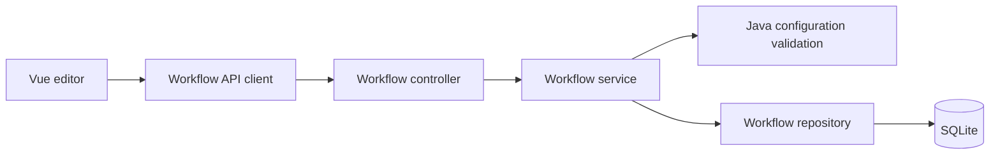

# Design: Save and load pipelines

## 1. Saving model

Based on your choices, the design supports:

- A **backend-managed library** of named workflows.
- **One local user**, without accounts or permissions.
- **Pipeline definitions only**—input text and execution results are not saved.
- Explicit **Save** and **Save as** actions.

A saved workflow is a reusable recipe. For example, “Normalize whitespace → Change case → URL encode” can be opened later and applied to different input text.

## 2. What gets saved

A workflow document would look like this:

```json
{
  "id": "server-generated-uuid",
  "name": "Clean and encode text",
  "schemaVersion": 1,
  "revision": 1,
  "createdAt": "2026-10-23T12:00:00Z",
  "updatedAt": "2026-10-23T12:00:00Z",
  "pipeline": [
    {
      "transformation": "normalize-whitespace",
      "parameters": {
        "trimEdges": true,
        "preserveLineBreaks": false
      }
    },
    {
      "transformation": "url-codec",
      "parameters": {
        "mode": "Encode"
      }
    }
  ]
}
```

Important distinctions:

- **Array order is execution order.** Repeated transformations are allowed.
- **Transformation IDs and parameter values** are saved, rather than labels, descriptions, icons, or frontend components.
- Parameter defaults are resolved and stored explicitly, preserving choices if defaults later change.
- Vue’s numeric step `key` is excluded. Loading generates fresh keys.
- `schemaVersion` identifies the document format.
- `revision` increases on every update to prevent accidental overwrites; it does not provide version history.
- Input text, final output, intermediate results, tooltip state, and loading/error state are excluded.

## 3. Backend and storage

Use a local **SQLite database** accessed through Spring JDBC. This fits the selected single-user application without requiring a separate database server. [SQLite guidance](https://www.sqlite.org/whentouse.html), [Spring JDBC documentation](https://docs.spring.io/spring-framework/reference/data-access/jdbc/core.html).



Keep these responsibilities separate:

| Layer | Responsibility |
|---|---|
| Controller | HTTP requests, responses, and status codes |
| Service | Save/load rules, validation, revision checks |
| Repository | Database queries and transactions |
| Transformation library | Configuration validation and execution, independent of storage |

Use one `workflows` table with ID, name, definition JSON, revision, and timestamps. The JSON contains the schema version and ordered pipeline. This avoids database changes whenever a new transformation introduces different parameters.

Store the database outside build output: default to `~/.textflow/workflows.db`, configurable through `TEXTFLOW_DATA_DIR`. Tests use temporary databases. Database initialization and future schema changes use versioned SQL migrations.

### API

| Endpoint | Purpose |
|---|---|
| `GET /api/workflows` | List summaries, newest updated first |
| `POST /api/workflows` | Create a named workflow |
| `GET /api/workflows/{id}` | Retrieve its complete definition |
| `PUT /api/workflows/{id}` | Update using the expected revision |
| `DELETE /api/workflows/{id}` | Delete using the expected revision |

Create/update return the stored document. Use `400` for invalid definitions, `404` for missing workflows, `409` for revision conflicts, and `413` for oversized requests. Extend the existing 1 MiB request limit to workflow writes.

The existing execution endpoint remains unchanged.

## 4. Editor behavior and failure handling

Add a workflow toolbar with **New**, **Open**, **Save**, **Save as**, and **Delete**, alongside the workflow name and saved/unsaved indicator.

- **First Save:** ask for a name, then create the record.
- **Save:** update the currently opened workflow.
- **Save as:** create a separate record with a new ID.
- **Open:** replace the pipeline, retain the current input, and regenerate the preview.
- **New:** clear the selected workflow and pipeline, retaining input.
- **Delete:** require confirmation before removing the saved record.

Only pipeline and name changes mark the workflow dirty. Input edits do not.

Before replacing dirty work through New, Open, or Load example, offer **Save / Discard / Cancel**. A failed save preserves the editor and unsaved indicator. If editing continues during a save, the response must not incorrectly mark those newer edits as saved.

Validation must not require input text: a valid substring configuration can be saved even when the current input is too short. Share configuration validation with the Java processor rather than duplicating transformation rules in controllers.

On loading an older definition:

- Preserve unavailable transformations and flag them clearly.
- Pause automatic execution until incompatibilities are resolved.
- Never silently drop steps or substitute changed defaults.
- Reject unsupported document versions without replacing the current editor.

For a revision conflict, retain local edits and offer reopening the latest saved version or **Save as** a separate workflow.

## 5. Acceptance criteria and boundaries

Verify that:

- Saved workflows survive backend restarts.
- Order, repeated steps, Unicode, empty strings, `false`, and zero round-trip correctly.
- Input and results are never persisted.
- Loading applies the workflow to the current input.
- Save failures and conflicting updates preserve local work.
- Missing transformations and unsupported versions produce actionable messages.
- Saving during continued editing leaves newer changes unsaved.
- Database tests verify atomic writes and revision checks.

This first version excludes autosave, authentication, sharing, execution history, revision history, and JSON import/export. Existing transformation IDs and parameter semantics remain backward compatible; breaking transformation behavior requires a new ID.

No implementation has been performed.
